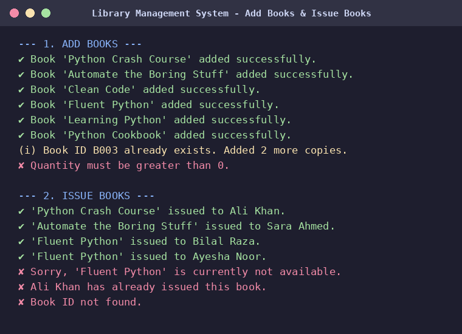
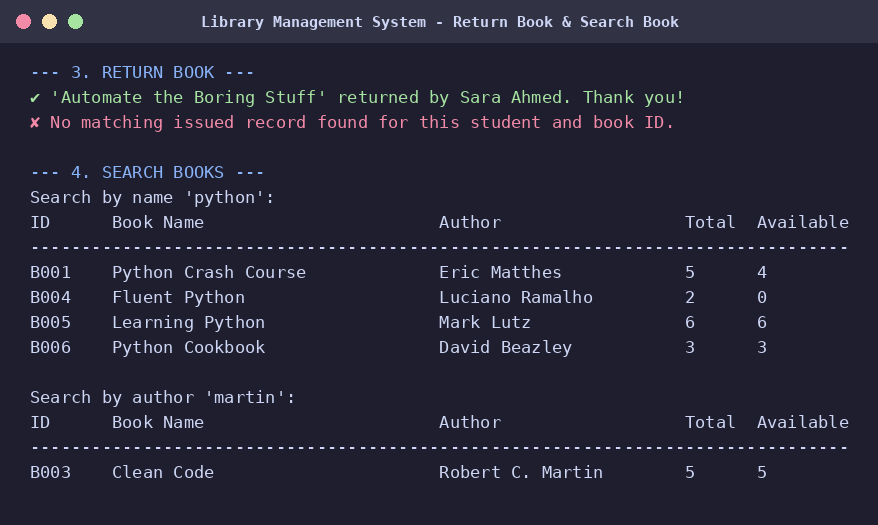
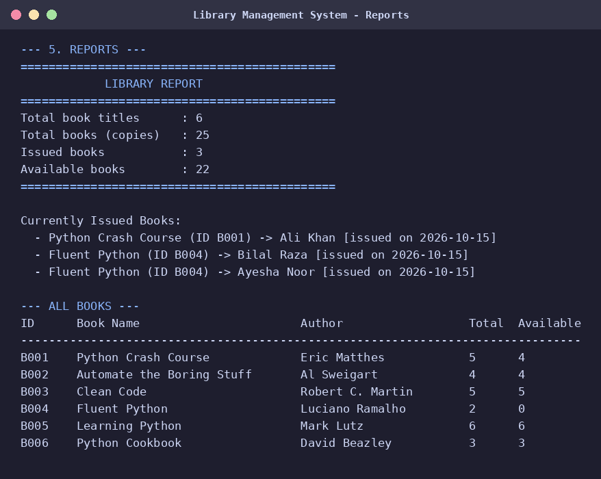
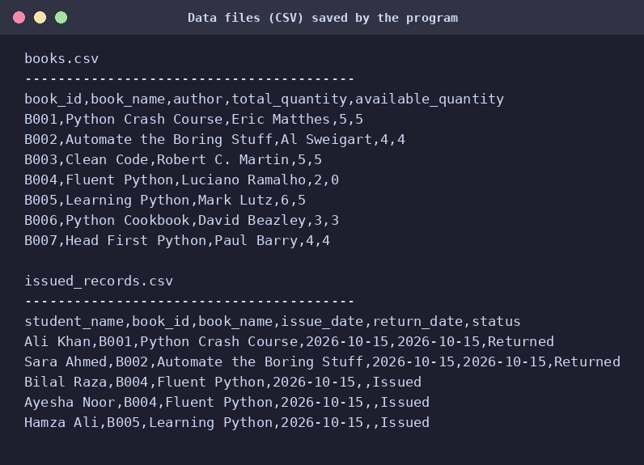
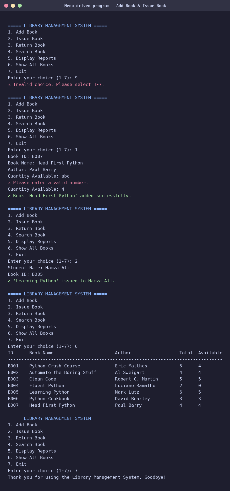
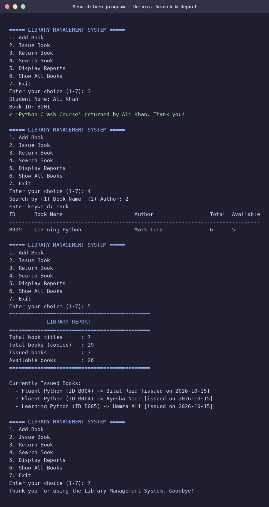

# 📚 Library Management System (Python)

A menu-driven mini Library Management System built with Python to manage books and student issue/return records. All data is stored in CSV files, so it stays saved after the program closes.

## Features
- **Add Books** – Book ID, Book Name, Author, Quantity Available
- **Issue Book** – asks student name and book ID, reduces available quantity, stores the issue record
- **Return Book** – marks the record as returned and updates the quantity
- **Search Book** – by book name or author name (case-insensitive, partial match)
- **Display Reports** – total books, issued books, available books, currently issued list
- **File Handling** – `books.csv` and `issued_records.csv`
- **Exception Handling** – invalid numbers, missing files and wrong IDs do not crash the program

## Concepts Covered
Functions • Loops • Lists & Dictionaries • File Handling • Exception Handling • Menu-driven Programs

## Project Structure
```
Library-Management-System/
├── Library_Management_System.ipynb   # main notebook (code + demo output)
├── sample_data/
│   ├── books.csv                     # sample book records
│   └── issued_records.csv            # sample issue/return records
├── screenshots/                      # output screenshots
└── README.md
```

## How to Run
1. Install Python 3 and Jupyter Notebook (or use Google Colab). No extra libraries are needed, only the Python standard library (`csv`, `os`, `datetime`).
2. Open `Library_Management_System.ipynb`.
3. Run all cells from top to bottom. The **Demo** cell shows sample output.
4. Run the last cell (`main()`) to use the interactive menu.

The CSV files are created automatically in the same folder as the notebook. Note: the Demo cell resets them to the sample data.

## Menu
```
1. Add Book
2. Issue Book
3. Return Book
4. Search Book
5. Display Reports
6. Show All Books
7. Exit
```

## Screenshots
| Add books & issue | Return & search |
|---|---|
|  |  |

| Reports | CSV files |
|---|---|
|  |  |

| Interactive menu (add & issue) | Interactive menu (return, search, report) |
|---|---|
|  |  |

## Author
Sumaira – Python Assignment
